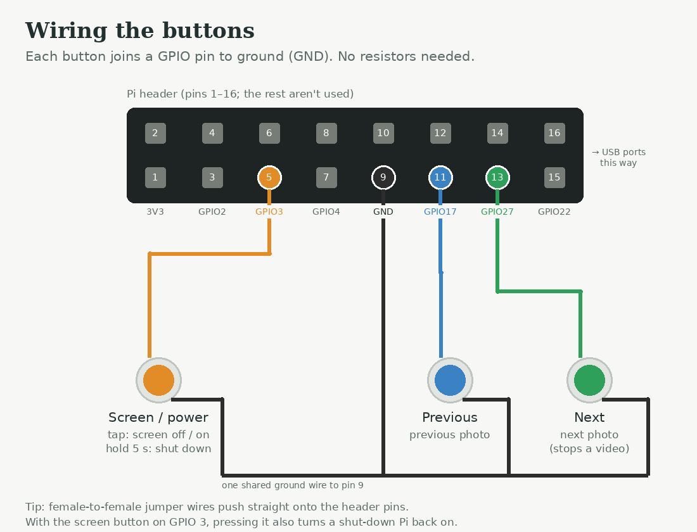

<p align="center"></p>

# Pi Frame

Pi Frame is a digital photo frame for a Raspberry Pi (Zero 2 W or 4) and a portable HDMI screen,
built to be a drop-in member of the [esp32-photoframe](https://github.com/aitjcize/esp32-photoframe)
ecosystem. It speaks the same HTTP API and image-server protocol as the ESP32
firmware, so these all work with it unchanged:

- [esp32-photoframe-server](https://github.com/aitjcize/esp32-photoframe-server) (including the Home Assistant add-on)
- the [ha-esp32-photoframe](https://github.com/aitjcize/ha-esp32-photoframe) Home Assistant integration
- any "Auto Rotate URL" source, such as HA Puppet dashboards

Rather than porting the firmware (ESP-IDF C written around e-paper drivers,
deep sleep and palette dithering), this re-implements its behaviour for an RGB
LCD: no dithering, full colour, and a screen schedule instead of deep sleep.

Internally the project is still called `pi-photoframe` (the app folder, the
`pi-photoframe` service, `/opt/pi-photoframe` and `/var/lib/pi-photoframe`),
so existing installs and web updates keep working.

## Features

- Photos from albums stored on the Pi, or from an image server URL
- Rotation schedule using the firmware's cron rules (`minute hour day-of-week`), shuffle or in order
- Fit the whole photo (with a soft blurred backdrop, or black/white) or fill the screen
- Two-photo collages when a photo's orientation doesn't suit the screen
- Cross-fade transitions, previous/next, show any photo on demand
- Videos: short clips and long ones, played full screen with hardware decoding, then back to photos
  (kept at 1080p at most, the Pi 4's hardware decoding limit, and scaled up to fill bigger screens)
- On-screen info: time and date, weather, and when and where each photo was taken
- Physical Previous / Next / Screen buttons, with hold-to-shut-down and press-to-power-on
- Screen off overnight (HDMI blanking, plus optional custom commands such as HDMI-CEC)
- Portrait or landscape mounting, with a 180° flip
- Web page for your phone: albums, drag-and-drop upload, schedule and settings
- Optional frame password, Home Assistant notifications, `<hostname>.local` via mDNS
- With no photos, the screen shows a QR code that opens the upload page
- If Wi-Fi fails, the frame starts its own setup hotspot and shows QR codes to join it and pick a network

## Hardware

- Raspberry Pi Zero 2 W (Wi-Fi is 2.4 GHz only)
- Portable HDMI screen, a mini-HDMI to HDMI cable or adapter, and a power supply
  that can run both. Many portable screens draw more than the Pi's port can
  supply, so power the screen separately if it flickers or reboots.
- A microSD card (16 GB or more)

## Install

1. Flash **Raspberry Pi OS Lite (64-bit)** with Raspberry Pi Imager. In its
   settings, set the hostname to `photoframe`, your Wi-Fi, and enable SSH.
2. Connect the screen **before** powering on, so the Pi picks its resolution.
3. SSH in, then:

   ```sh
   sudo apt install -y git
   git clone <your copy of this repo> ~/pi-photoframe
   sudo ~/pi-photoframe/deploy/install.sh
   sudo reboot
   ```

   If the picture is the wrong resolution, or the screen isn't always switched
   on at boot, force a mode: `sudo ./deploy/install.sh --mode 1920x1080`.

4. Open `http://photoframe.local/` on your phone.

The installer puts the app in `/opt/pi-photoframe`, data in
`/var/lib/pi-photoframe`, runs it as a `photoframe` service user, lets that
user manage Wi-Fi through NetworkManager (a polkit rule), adds a captive-portal
DNS rule for the setup hotspot, disables the
login prompt on the HDMI console, and appends `consoleblank=0
vt.global_cursor_default=0` to `cmdline.txt` (a backup is kept as
`cmdline.txt.pre-photoframe`). Boot messages still show on the screen until
the first photo appears.

Update later from the web page (Maintenance → Software update), or over SSH by
unzipping a new package and running its `sudo ./deploy/install.sh`. View logs
with `journalctl -u pi-photoframe -f`.

## Videos

Big files upload in 8 MB pieces written straight to the SD card, so a dropped
connection just retries, and if the page is closed or refreshed you can choose
the same file again to carry on where it stopped. Unfinished uploads are kept
for a week. Upload speed is shown while it runs; if it's slow (under a few
MB/s), plug the Pi into your router with an Ethernet cable for big uploads, or
shrink the video first (see below).

Upload videos the same way as photos. Each one is checked first:

- **H.264 videos up to 1080p** (typical of videographers' exports and older
  phones) are stored as they are and are ready straight away.
- **Everything else** (iPhone HEVC, HDR or Dolby Vision, 4K, 60 fps) is
  converted in the background to 1080p, 30 fps H.264, with HDR tone-mapped so
  it doesn't look washed out. The Photos tab shows progress. On a Pi 4, expect
  very roughly a few minutes per 30 seconds of 4K phone video; conversion runs
  at low priority so the slideshow carries on. To skip the wait, export clips
  as 1080p H.264 first (e.g. HandBrake's "Fast 1080p30" preset), or set the
  iPhone to Settings → Camera → Formats → Most Compatible with HDR Video off.

When a video comes up in the slideshow, it plays once (or up to the limit set
under Display → Videos), then the frame moves on to the next photo. Scheduled
changes never cut a video short; Stop video (the Next button) does. Tap a
video in the Photos tab to play it now.

Sound is off by default. When it's on, the frame sends it to the HDMI port the
screen is plugged into (not the Pi's headphone jack). Each video's loudness is
measured when it's imported (EBU R128, the broadcast standard; it reads only
the soundtrack, so it's quick) and played back levelled to -16 LUFS, so quiet
and loud videos come out at a similar volume. The file itself isn't changed.
Videos imported before this existed are measured in the background. Turn it
off under Display → Videos. If everything is still too quiet with the screen
turned up, add Volume boost (+6 or +12 dB); a limiter keeps loud moments from
distorting. Test the screen's
speakers with `speaker-test -D hdmi:CARD=vc4hdmi0,DEV=0 -c 2 -t sine -l 1`
(a Zero 2 W's card is `vc4hdmi`). To use a different output, set
`PHOTOFRAME_AUDIO_DEVICE` in the service file (see the commented example).

Videos are meant for a Pi 4. A Zero 2 W can play 1080p H.264, but converting
uploads on it is very slow and memory is tight.

Videos copied onto the SD card by hand (not uploaded) are not converted, so
use compatible H.264 files for those.

## Smoother fades and better colour (32-bit)

Raspberry Pi OS usually gives the console framebuffer 16-bit colour, which
shows faint banding in skies and makes fades slower. Check with:

```sh
cat /sys/class/graphics/fb0/bits_per_pixel
```

If it says `16`, ask for 32-bit by adding a video mode with `-32` to the end of
`/boot/firmware/cmdline.txt` (keep it all on one line, back the file up first,
and use your screen's resolution):

```sh
sudo cp /boot/firmware/cmdline.txt /boot/firmware/cmdline.txt.bak
sudo sed -i '1 s/$/ video=HDMI-A-1:1920x1080-32@60/' /boot/firmware/cmdline.txt
sudo reboot
```

After rebooting, check `bits_per_pixel` again. The frame adapts automatically.
`journalctl -u pi-photoframe` logs the frame rate of every fade.

## Using the image server

The stock image server converts every photo to 6-colour dithered e-paper
output, which looks poor on an LCD. `server-patch/full-colour-frames.patch`
adds a full-colour path: frames that report `display_type: rgb` get a plain
JPEG instead. Everything else (sources, collage, date/weather overlays,
history, config sync) is unchanged, and e-paper frames are unaffected.

```sh
git clone https://github.com/aitjcize/esp32-photoframe-server
cd esp32-photoframe-server
git apply /path/to/pi-photoframe/server-patch/full-colour-frames.patch
docker build -t esp32-photoframe-server:full-colour .
```

To run the patched server as the Home Assistant add-on, copy the patched
repository into `/addons/` on your HA host (via the Samba or SSH add-on), then
install it from Settings → Add-ons → Add-on store → Local add-ons. The
upstream `deploy-dev.sh` script automates this.

Then in the server dashboard, add a device with the host `photoframe.local`
and pick its image source. The server pushes its URL and access token to the
frame; switch the frame to "Image server" under Photo source if it doesn't
switch itself.

Without the patch, the frame still works with the server, but photos will
arrive dithered.

## On-screen info

Display → On-screen info. Small frosted-glass panels over the photos, in the
corner you choose (small, medium or large):

- **Time and date**, 12- or 24-hour, updated every minute.
- **Weather** for a place you search for: current temperature and conditions,
  today's high and low, and an icon. From Open-Meteo (free, no account),
  refreshed every 15 minutes.
- **Photo details**: when and where the photo on screen was taken, read from
  the photo itself (most phones record the date and GPS position), with place
  names from OpenStreetMap (looked up once per place and remembered). On a
  photo's anniversary it also says "2 years ago today".

Photo details are kept from uploads and synced folders from this version on;
photos added earlier lost theirs when they were resized, so add them again to
get their details. The panels drift by a few pixels each hour so nothing sits
on the same pixels for ever, and they're hidden while a video plays and on the
welcome and setup screens.

## Mixing it up

**Slideshow styles** (Schedule tab):

- **Classic**: one photo at a time, on the photo-change schedule.
- **Story**: a collage of 3, 4 or 5 photos (or a mix), then each of those
  photos full screen in turn, then a new collage.
- **Spotlight**: collage, one of its photos, back to the collage, the next
  photo, and so on.

Collage and single-photo times are set separately (e.g. 5 and 10 minutes).
Collage layouts suit landscape and portrait screens and put portrait photos in
tall spaces. Story and Spotlight apply to photos stored on the frame.

**Photos around videos** (Schedule tab, on by default): when a video doesn't
fill the screen, like a landscape video on a portrait screen (bands above and
below) or a phone video on a landscape screen (spaces at the sides), photos that
suit those spaces go around it, with the collage mat. The video plays in its
window (mpv's margin options) and the photos sit on mpv's overlay layer, which
the graphics chip draws with each frame at almost no cost. The opening frame is
shown in the window first, so the start is seamless.

**Video moments** (Schedule tab): every 15 minutes to 4 hours, a short clip
(10 s to 1 min) from a random point in a random video, then back to whatever
was showing.

**Jokes and fun facts** (Display → On-screen info): a small panel with a joke,
a fact, or both, changing with each picture, from a built-in family-friendly
collection (works offline). Add your own lines too, mixed in.

## Seeing what's on the frame

- **Tap the preview** on the web page to see it large, with the clock and other
  on-screen info exactly as on the screen, and a link to the full-resolution image.
- **Live view** (`http://piframe.local/live`): a full-window page that mirrors
  the screen, following each change within a couple of seconds with a fade.
  Its controls (full screen, settings) hide when idle, and it keeps a tablet or
  phone awake, so an old tablet can act as a second frame.

## Screen resolution

Maintenance → Screen resolution lists the resolutions your screen reports, up
to its native one (bigger modes some monitors accept and shrink, like 4K on a
1440p screen, are left out: twice the work for the Pi, nothing gained). Swapped
monitors? Press **Re-check the screen** so the Pi reads the new screen's
details without a restart. Pick a resolution and press Apply and restart
(changing resolution needs a restart).
A small root helper (`pi-frame-system.path`) makes the boot-setting change,
backed up first to `cmdline.txt.pre-resolution`, and accepts only resolutions
the screen offers. If the screen stays blank afterwards, change it back from
the same page on your phone. When you change the resolution here, the boot
screens are remade for the new size before the restart (about a minute), so
the first boot is already right; turning the screen (orientation) remakes them
straight away. A monitor swapped without using this page is caught at the next
start, and the boot screens are remade then.

## Boot screen

The installer replaces the Pi's boot visuals with Pi Frame's own:

- **No rainbow square** at power-on (`disable_splash=1` in config.txt).
- **The Pi Frame logo**, drawn by the kernel from the first seconds of boot,
  instead of the four raspberries and scrolling text, using Raspberry Pi's
  official `rpi-splash-screen-support`. It's made for your screen's resolution
  and orientation; after changing the orientation, re-run the installer (or
  install the next update) to turn the boot logo to match.
- **No console text over the logo, the photos or the shutdown screen.** The
  console moves to a hidden screen (`console=tty1` becomes `console=tty3`), and
  `loglevel=5` limits the kernel's on-screen log to warnings (any lower, and
  the kernel stops drawing its logo). About 5 seconds into boot,
  `pi-frame-splash.service` switches the screen to graphics mode, so no console
  text appears from then on, and redraws the logo over the few warnings printed
  before it. The frame keeps graphics mode on while it runs, so stray kernel
  messages never land on a photo, and the "Shutting down…" / "Restarting…"
  screen stays up until the screen goes dark.

  (Raspberry Pi's own tool removes the screen console entirely instead; on a Pi
  whose serial port is off, the default on a Pi 4, that leaves no console and
  boot stops at the logo.)

Boot settings are backed up to `cmdline.txt.pre-bootsplash` and
`config.txt.pre-bootsplash` first. To go back to the normal boot text:
`sudo python3 /opt/pi-photoframe/deploy/bootsplash.py remove` and reboot. To
skip it when installing: `sudo ./deploy/install.sh --no-boot-splash`.

## Without a screen

If no screen is connected at start-up, the frame runs without one: the website,
syncs, uploads, buttons and presence sensor all keep working, pictures are
composed at the last known screen size (so stored photos stay sharp), videos
are skipped, and the boot logo is left alone. When a screen is plugged in, the
frame notices within a few seconds and restarts itself to use it.

## Smooth fades (display hardware)

Fades run on the display hardware: the new picture goes on a second display
layer whose opacity rises once per screen refresh, and the hardware blends the
layers as it sends the picture out, so fades run at a steady 60 fps (even at
1440p) with almost no work for the processor. Plain changes flip between two
screen buffers at a refresh, so a half-drawn picture is never shown. The
screen is handed to mpv while a video plays and taken back afterwards.

Needs `python3-kms++` (the installer adds it). If the display hardware isn't
available or doesn't start, the frame falls back to processor fades (slower,
around 14 fps at 1440p on a Pi 4) and says why in Recent activity. Display →
Fades switches it off. `deploy/kms_fade_test.py` checks a Pi step by step.

## Monitor brightness

Display → Monitor brightness. Most desktop monitors accept settings over the
HDMI cable (DDC/CI). The frame uses this to set the monitor's real backlight
brightness, a dimmer **night level** between times you choose (e.g. 90% by day,
35% from 21:00 to 07:00), and optionally to put the monitor itself into
**standby** when the screen turns off on its schedule (and wake it again).

Monitors store brightness in a memory chip that wears with constant
rewriting, so the frame writes only when the target changes: when you let go
of a slider, and when night starts and ends. If DDC/CI doesn't work, check the
monitor's own menu has it switched on. Monitors without it (most small
portable screens) get the picture darkened instead (never below 15%).

## Presence sensor

Display → Presence sensor. A 24 GHz mmWave radar module (e.g. Waveshare HMMD /
S3KM1110, or HLK-LD2420) turns the screen on when someone is in the room and off
after nobody has been seen for a while (5 minutes by default). Radar senses
people even when they sit still, and works through thin plastic or wood, so the
sensor can hide inside the frame.

Wiring, 3.3 V only (these modules can be damaged by 5 V):
VCC → pin 17 (3.3 V), GND → pin 14, OT2 → pin 15 (GPIO 22).

By default it only wakes the screen within the screen schedule's on-hours. If
you switch the screen off by hand while you're there, it stays off until you've
left and someone comes back; switching it on by hand counts as someone being
there. A playing video, and the Wi-Fi setup and update screens, keep the screen
on. With the monitor-standby option, the monitor itself sleeps when nobody's
around. The settings page shows "Someone's here" / "Nobody seen for…" live, for
checking the sensor's range.

## Physical buttons

Display → Physical buttons. Three push buttons wired to the Pi's GPIO header:

| Button | Pin (default) | Tap | Hold |
|---|---|---|---|
| Screen / power | GPIO 3, pin 5 | screen off / on | shut down safely (5 s, adjustable) |
| Previous | GPIO 17, pin 11 | previous photo | |
| Next | GPIO 27, pin 13 | next photo, or stop a video | |

Each button's other leg goes to ground: all three can share one wire to pin 9.
No resistors are needed (the Pi's internal pull-ups are used). While the
screen is off, any button just turns it back on. On GPIO 3, pressing the screen
button after a shutdown turns the Pi back on (a built-in Pi feature), so it
works as a proper power button, and shutting down with it is much kinder to
the SD card than pulling the plug.



Any momentary (normally-open) push buttons work: small tactile switches, or
12–16 mm panel-mount buttons for fitting into a frame or case. Female-to-female
jumper wires push straight onto the header pins. The pins can be changed on
the settings page; the page also shows the last button pressed, for testing.

## Synced folders (OneDrive, Google Drive, Dropbox, NAS)

Photo source → Synced folders. Connect a service, pick a folder, and the frame
keeps an album in step with it: photos (including iPhone HEIC) and videos added
to the folder are downloaded, resized/converted like uploads, and appear on the
frame; changed files are replaced; files taken out of the folder are removed
from the frame (optional). Checks hourly by default, plus Sync now. One-way
only: the frame never writes to any of them. Photos you upload by hand into a
synced album are never touched by the sync. Several folders, from different
services, can be synced at once.

**OneDrive, Google Drive, Dropbox:** press Sign in, sign in as usual, and your
browser then lands on an address starting `http://localhost:53682/` or
`http://127.0.0.1:53682/` that won't load (it's meant for the Pi). Copy that
address into the frame and press Finish. Alternatively, paste the token printed
by `rclone authorize "onedrive"` (or `"drive"`, `"dropbox"`) run on a PC.
Google Drive access is read-only.

*Google Drive, your own API key (optional).* Google limits download speed for
shared apps, which slows the first sync of a big folder. To use your own free
key: at console.cloud.google.com create a project, enable the **Google Drive
API**, set up the **OAuth consent screen** (External; add yourself as a test
user, then **Publish app**, otherwise Google makes sign-ins expire after 7
days), then **Credentials → Create OAuth client ID → Desktop app**. Paste the
client ID and secret into "Use your own Google API key" before signing in.
Google will warn the app isn't verified: it's your own, so choose Advanced →
continue.

*rclone version.* Syncing uses rclone 1.67 or newer: older versions (including
Debian's 1.60) can list OneDrive folders but every download fails with
"unauthenticated" since a 2024 Microsoft change. The installer fetches the
current release from rclone.org (checksum-verified) into /usr/local/bin. To do
it by hand on a 64-bit Pi:

```sh
cd /tmp && curl -LO https://downloads.rclone.org/rclone-current-linux-arm64.zip
unzip -o rclone-current-linux-arm64.zip
sudo install -m 755 rclone-*-linux-arm64/rclone /usr/local/bin/rclone
```

**NAS or shared folder (SMB):** enter its address (e.g. `192.168.1.20` or
`mynas.local`), a username and password. Works with Synology, QNAP, Windows
shared folders and others that use SMB 2 or 3. A dedicated account with
read-only access to the photos folder is a good idea (on a Synology: Control
Panel → User, then give it read-only permission on the shared folder). Names
like `mynas.local` are looked up by the frame (rclone can't resolve `.local`
names by itself) and re-checked before each sync, so a NAS whose address
changes is still found; if a name isn't found, use the IP address. The
password is stored scrambled in the frame's private settings. It works without
the internet, and syncs are fast.

## Setup screens

**Welcome:** each time the frame starts, it shows a welcome screen with a QR
code for its web page for 30 seconds (Display → Starting up; 1–2 minutes or
off). It adds the IP address and network name once Wi-Fi connects. Pressing
Next photo skips it.

**No photos:** when there's nothing to show, the frame displays a QR code for
its web page (plus the `.local` address and IP). Scan it with a phone on the
same Wi-Fi to start uploading. The first photo replaces the card straight away.

**Wi-Fi setup:** if the frame isn't online within 2 minutes of starting (it
waits up to 5 minutes while the Pi is still part-way through connecting), or
loses Wi-Fi for more than 5 minutes, it starts a hotspot called
`PiFrame-XXXX` and shows two QR codes:

1. Join the frame's Wi-Fi (the password is on the screen, and changes each boot).
2. Open the setup page at `http://10.42.0.1/setup`. Most phones open it
   automatically as a "sign in to network" page.

Pick your network and enter its password. If it connects, the photos come
back; if not, the setup screen returns with an error. While the hotspot is up,
the frame retries your saved Wi-Fi every 3 minutes (unless someone is using
the setup page), so a router outage fixes itself once the router is back.

**Link check:** being connected isn't the same as working. While on Wi-Fi, the
frame pings the router (and 1.1.1.1 / 8.8.8.8) every 15 seconds. If none answer
twice in a row, it re-joins the network, preferring another access point of
the same network (e.g. the router's 5 GHz radio). Some routers park a newly
connected device on a band that passes no traffic for several minutes; this
fixes that within about 30 seconds. An internet outage alone doesn't trigger
it, because the router still answers. See it working with
`journalctl -u pi-photoframe | grep "link check"`.

The installer also turns off Wi-Fi power saving, which otherwise makes the Pi
slow to answer ping, SSH and the web page. The frame logs how long Wi-Fi took
to connect: `journalctl -u pi-photoframe | grep Wi-Fi`.

You can also change network from the web page (Photo source → Change Wi-Fi
network). This needs NetworkManager, the default on Raspberry Pi OS Bookworm
and later. Turn the fallback off with `Environment=PHOTOFRAME_WIFI_SETUP=0` in
the service file.

## Maintenance tab

Behind-the-scenes health at a glance: a green/amber/red summary, then Wi-Fi
(band, router radio, signal, speed, link-check results and every automatic
re-join), power (CPU temperature, under-voltage and throttling since boot),
SD card (free space, read-only state, and any card errors the kernel has
logged), screen and slideshow (colour depth, last fade frame rate), photos and
videos (conversions, unfinished uploads), system details, and the frame's
recent activity log with a "only problems" filter.

Actions: check the network now, restart the frame software, reboot the Pi, and
download a diagnostics text file (status plus recent frame, network, Wi-Fi and
kernel logs; passwords, tokens and keys removed).

**Software update:** upload a new pi-photoframe zip on the Maintenance tab.
The frame checks it's a genuine package and shows the version change before
you confirm. A separate root updater (`pi-photoframe-update.path` watching
`/var/lib/pi-photoframe/update/`) keeps a copy of the current version, runs the
new package's `install.sh`, then checks the frame comes back up reporting the
new version. If the installer fails or the frame doesn't start within 90
seconds, the previous version is put back automatically. While it installs, the frame's screen shows an "Updating Pi Frame" screen
with the steps (unpack, back up, install, check) filling in, and the slideshow
pauses; after the restart it confirms "Updated to version …" (or says the
update didn't work and the previous version is back) before the photos return.
Because an update can
install any code, it only works once the page has a password (Maintenance →
Page password). The updater itself is set up by `install.sh`, so run that once
over SSH first.

The installer lets the service read the system log (for the SD card check) and
reboot the Pi, and makes logs persist across reboots.

## Home Assistant

Add the ESP32 PhotoFrame integration with host `photoframe.local`. Rotate,
current image, config entities and the notify callback all work. Battery,
sensor and OTA entities show as unavailable, since the Pi has none of those.

## Portrait mounting

Choose Portrait under Display. The layout assumes the screen has been turned
anticlockwise from landscape. If photos appear upside down, choose
"Upside down (180°)".

## API

All firmware endpoints in esp32-photoframe's `docs/API.md` are implemented
(e-paper-only ones such as palette calibration and OTA return friendly
errors). Additions:

| Endpoint | Purpose |
| --- | --- |
| `POST /api/previous` | Go back to the previous photo |
| `GET/POST /api/screen` | Read or set screen power, `{"on": true}` |
| `GET /api/status` | Current photo, next change time, screen state |
| `GET /api/wifi/status`, `GET /api/wifi/networks`, `POST /api/wifi/connect` | Wi-Fi setup |
| `GET /setup` | Wi-Fi setup page |
| `GET /api/jobs` | Video conversion progress |
| `POST /api/video/stop` | Stop the playing video |

Extra config fields: `screen_schedule_enabled`, `screen_on_time`,
`screen_off_time`, `transition` (`fade`/`none`), `transition_ms`,
`local_collage`. `POST /api/sleep` turns the screen off.

## Development

Runs on any Linux or macOS machine, writing frames to a PNG instead of HDMI:

```sh
pip install flask pillow numpy requests qrcode pytest
sudo apt install ffmpeg      # for video uploads (mpv isn't needed: playback is simulated)
python3 -m photoframe --data-dir /tmp/pf --display file:1920x1080:/tmp/frame.png --port 8080
python3 -m pytest tests
```

## Status

The app and its test suite run. The server patch is `gofmt`-clean but hasn't
been compiled yet, so check `docker build` succeeds before deploying it.
Not yet tested on real Pi hardware.
