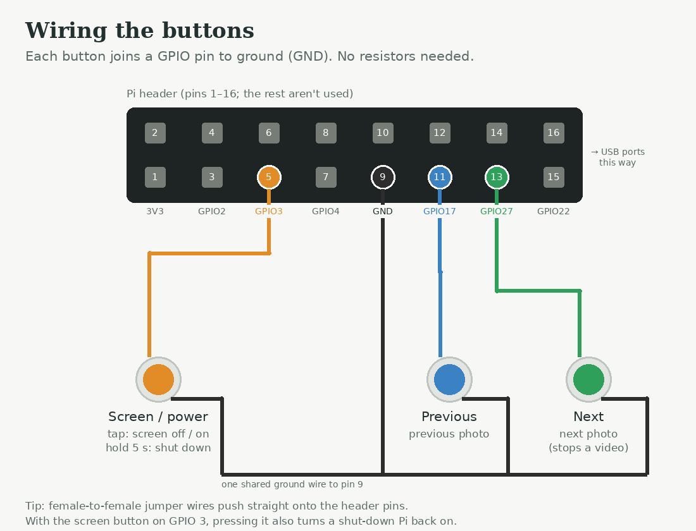

# Screen and hardware

[← Back to the README](../README.md)

- [Screen resolution](#screen-resolution)
- [Fades and colour](#fades-and-colour)
- [Boot screen](#boot-screen)
- [Running without a screen](#running-without-a-screen)
- [Monitor brightness and standby](#monitor-brightness-and-standby)
- [Presence sensor](#presence-sensor)
- [Physical buttons](#physical-buttons)
- [Power](#power)

## Screen resolution

Maintenance → Screen resolution lists the resolutions the screen reports,
up to its native one. (Bigger modes some monitors accept and shrink, like
4K on a 1440p screen, are left out: twice the work for the Pi, nothing
gained.) Pick one and press **Apply and restart**.

- Swapped monitors? Press **Re-check the screen** so the Pi reads the new
  screen's details without a restart.
- Only resolutions the screen offers are accepted. The boot setting is
  backed up to `cmdline.txt.pre-resolution` before the first change. If the
  screen stays blank afterwards, change it back from the same page on your phone.
- The boot screen is remade for the new size before the restart (about a
  minute), so the first boot already looks right. A monitor swapped without
  using this page is noticed at the next start, and the boot screen is remade then.

From SSH, the installer does the same: `sudo ./deploy/install.sh --mode 2560x1440`.

## Fades and colour

Fades run on the Pi's display hardware. The new picture goes on a second
display layer whose opacity rises with each screen refresh, and the hardware
blends the two layers as it sends the picture out, so fades run at a steady
60 fps, even at 1440p, with almost no work for the processor. Plain changes
switch between two screen buffers at a refresh, so a half-drawn picture is
never shown. The screen is handed to the video player while a video plays
and taken back afterwards.

This needs `python3-kms++` (the installer adds it). If the display hardware
isn't available, the frame falls back to drawing fades with the processor
(around 14 fps at 1440p) and says why in Recent activity. Display → Fades
can switch hardware fades off. `deploy/kms_fade_test.py` checks a Pi step
by step and reports the frame rate:

```sh
sudo systemctl stop pi-photoframe
python3 deploy/kms_fade_test.py
sudo systemctl start pi-photoframe
```

The installer's `--mode` option (and the Screen resolution page) also asks
for 32-bit colour. Raspberry Pi OS otherwise often gives the screen 16-bit
colour, which shows faint banding in skies. Check with
`cat /sys/class/graphics/fb0/bits_per_pixel` (it should say 32).

## Boot screen

The installer replaces the Pi's boot visuals with Pi Frame's own:

- **No rainbow square** at power-on (`disable_splash=1` in `config.txt`).
- **The Pi Frame logo** from the first seconds of boot, instead of the
  raspberries and scrolling text, using Raspberry Pi's
  `rpi-splash-screen-support`. It's made for the screen's resolution and
  orientation, and remade when either changes.
- **"Starting up… this takes about a minute"** under the logo, until the
  first photo appears.
- **No text over the logo, the photos, or the "Shutting down…" screen.**

How the text is kept away: the console moves to a hidden screen
(`console=tty1` becomes `console=tty3`) and `loglevel=5` keeps the kernel's
on-screen messages to warnings. About 5 seconds into boot,
`pi-frame-splash.service` switches the screen to graphics mode and redraws
the logo, and the frame keeps graphics mode on while it runs.

Lessons learned getting here, in case you change these settings:

- Don't remove `console=tty1` without adding another console. On a Pi 4 the
  serial port is off, so that leaves no console at all and boot stops at the
  logo. (This is what Raspberry Pi's own tool does.)
- `loglevel` 4 or lower stops the kernel drawing its logo.

Boot settings are backed up to `cmdline.txt.pre-bootsplash` and
`config.txt.pre-bootsplash` first. To go back to the normal boot text:
`sudo python3 /opt/pi-photoframe/deploy/bootsplash.py remove`, then reboot.

## Running without a screen

If no screen is connected at start-up, the frame runs without one: the
website, syncs, uploads, buttons and presence sensor keep working, pictures
are made at the last screen size, and videos are skipped. When a screen is
plugged in, the frame notices within a few seconds and restarts itself to use it.

## Monitor brightness and standby

Display → Monitor brightness. Most desktop monitors accept settings over
the HDMI cable (DDC/CI). The frame uses this for:

- the monitor's real backlight brightness,
- a dimmer **night level** between times you choose (e.g. 90% by day, 35%
  from 21:00 to 07:00),
- optionally, putting the monitor into **standby** when the screen turns off
  (and waking it again).

Monitors store brightness in a memory chip that wears with constant
rewriting, so the frame only writes when the level changes. If it doesn't
work, check DDC/CI is switched on in the monitor's own menu. Screens
without it (most small portable ones) get the picture darkened instead,
never below 15%.

For screens that ignore both, custom on/off commands (e.g. HDMI-CEC) can be
set in the service file: see the commented examples in
`deploy/pi-photoframe.service`.

## Presence sensor

Display → Presence sensor. A 24 GHz mmWave radar module (Waveshare HMMD,
which is the S3KM1110, or HLK-LD2420) turns the screen on when someone is in
the room and off once nobody has been seen for a while (5 minutes by
default). Radar senses people even when they sit still and works through
thin plastic or wood, so the sensor can hide inside the frame.

Wiring, 3.3 V only (5 V can damage these modules):

| Sensor | Pi pin |
| --- | --- |
| VCC | pin 17 (3.3 V) |
| GND | pin 14 |
| OT2 | pin 15 (GPIO 22) |

Only the OT2 output is needed; the serial pins add nothing the frame uses.

By default it only wakes the screen within the screen schedule's on-hours.
If you switch the screen off by hand while you're there, it stays off until
you've left and someone comes back. A playing video and the setup and update
screens keep the screen on. The settings page shows "Someone's here" /
"Nobody seen for…" live, for checking the sensor's range.

## Physical buttons

Display → Physical buttons (tick **Use physical buttons** first). Three push buttons on
the Pi's GPIO header:

| Button | Pin (default) | Tap | Hold |
| --- | --- | --- | --- |
| Screen / power | GPIO 3, pin 5 | screen off / on | shut down safely (5 s, adjustable) |
| Previous | GPIO 17, pin 11 | previous photo | |
| Next | GPIO 27, pin 13 | next photo, or stop a video | |

Each button's other leg goes to ground; all three can share one wire to
pin 9. No resistors are needed (the Pi's own pull-ups are used). While the
screen is off, any button just turns it back on.

On GPIO 3, pressing the screen button after a shutdown turns the Pi back on
(a built-in Pi feature), so it works as a proper power button, and shutting
down with it is much kinder to the SD card than pulling the plug.



Any momentary (normally open) push buttons work: small tactile switches,
or 12–16 mm panel-mount buttons for fitting into a frame. Female-to-female
jumper wires push straight onto the header pins. The pins can be changed on
the settings page, which also shows the last button pressed, for testing.

## Power

Use the official Raspberry Pi 4 power supply (5.1 V, 3 A), or one that
holds its voltage under load. Maintenance shows under-voltage and
throttling since the last start; `vcgencmd get_throttled` should say
`throttled=0x0`.
